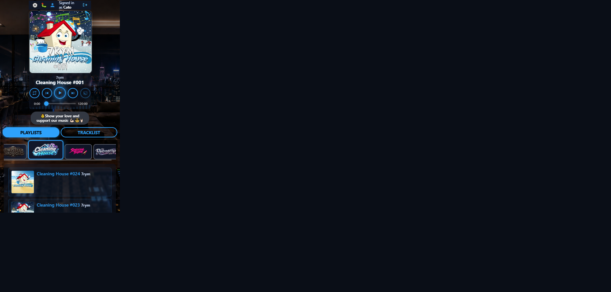
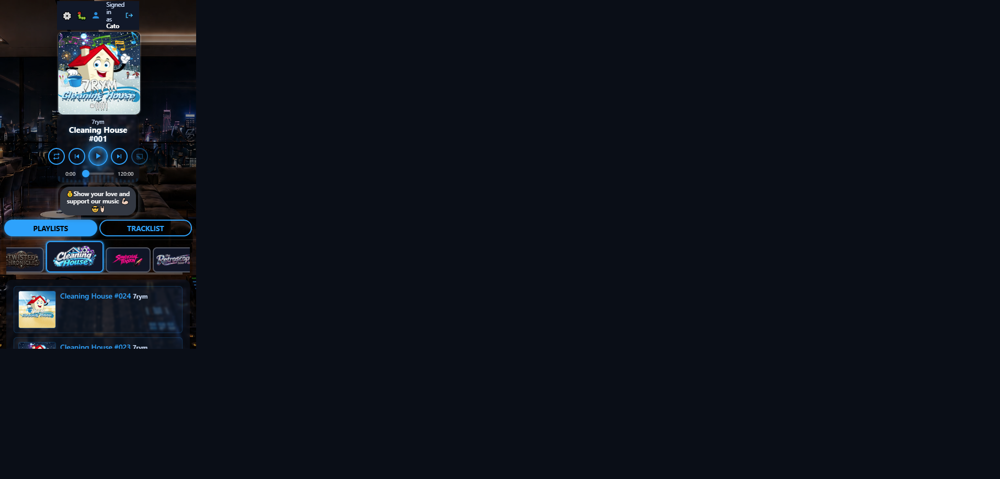
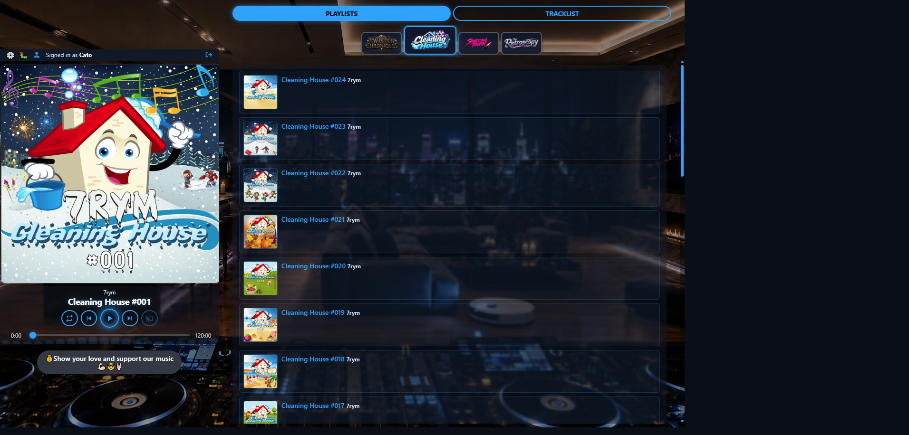
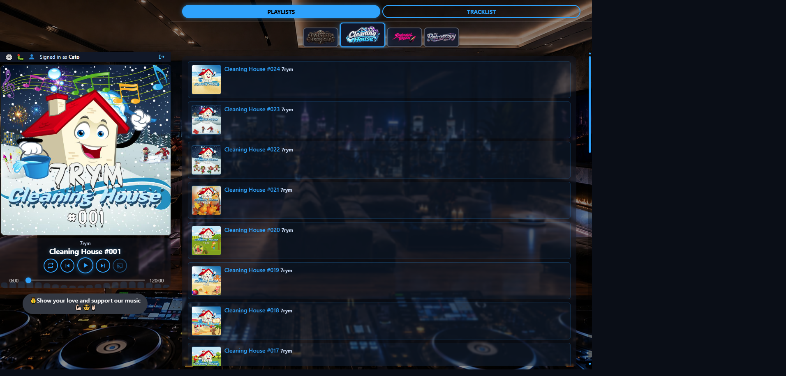

# Player size visual audit — round 2 (18 Oct 2026)

**Host:** local `http://127.0.0.1:8000/play` (Cleaning House)  
**Compared to:** [round 1 report](../player-size-2026-10-18/REPORT.md)  
**Changes in this round:** stacked covers capped so Playlists peek above the fold; Log out → icon; desktop rail centres the tight chrome stack.

**Scales under test**

| Preset | Stacked | Split (desktop) | Short landscape |
|--------|--------:|----------------:|----------------:|
| Large  | 0.62    | 1.0             | 1.0             |
| Normal | 0.52    | 0.9             | 1.0             |
| Small  | 0.42    | 0.75            | 0.92            |

**Capture caveat:** Cursor letterboxes emulated phone viewports inside a wider frame. Judge chrome *inside* the content box; trust measured fold metrics.

**Missing frame:** Short-landscape **Normal** = same short scale as Large (`1.0`) — not captured separately.

### Scorecard (operator-aligned)

| Mode | Large | Normal | Small |
|------|-------|--------|-------|
| Stacked portrait | **Pass** | **Pass** | **Pass\*** |
| Short landscape | **Pass** | **Pass** (= Large) | **Pass** |
| Desktop split | **Pass** | **Pass** | **Pass** |

\*Stacked Small: playlist peeks well; user strip can wrap on the narrow rail (~158px) — icon logout helps but tools+name still tight.

---

## 1. Stacked portrait (375×667)

### 1.1 Large — `r2-stacked-large.png`

| Measure | Value |
|---------|------:|
| Cover | ~233px (scale 0.62) |
| Mediplayer height | ~425px |
| Content peek below player | **~240px** |
| Playlists toggle visible | Yes |
| Campaign strip / first option above fold | **Yes** |
| Title/control overlap | No |
| Log out | Icon (`aria-label="Log out"`) |

**Comments**

- Addresses round-1 / tester fail: cover no longer fills the phone width or buries content.
- Playlists + campaign chips + start of list are visible without scrolling.
- Transport still natural-height; controls usable.

**Fair evaluation:** **Pass.** Meets the “must see there is a playlist” bar for Large.

---

### 1.2 Normal — `r2-stacked-normal.png`

| Measure | Value |
|---------|------:|
| Cover | ~195px (scale 0.52) |
| Content peek | **~274px** |
| First campaign option above fold | **Yes** |
| Title/control overlap | No |

**Comments**

- Clear step down from Large; more list rows above the fold (description shows #024 and #023).
- Round-1 fail (“first playlist item not above fold”) is resolved.

**Fair evaluation:** **Pass.**

---

### 1.3 Small — `r2-stacked-small.png`

| Measure | Value |
|---------|------:|
| Cover | ~158px (scale 0.42) |
| Content peek | **~253px** |
| First campaign option above fold | **Yes** |
| User strip height | ~55px (can wrap on narrow rail) |
| Title/control overlap | No |

**Comments**

- Smallest cover; playlist presence is obvious.
- Narrow mediaplayer (~158px) makes the user strip crowded — logout-as-icon helps; “Signed in as…” may still wrap.
- Operator ask to shrink further vs previous Small is satisfied vs round 1 (was 0.8 / ~300px).

**Fair evaluation:** **Pass\*** — content fold OK; polish user-strip density on very narrow stacked rails if needed.

---

## 2. Short landscape (667×375)

### 2.1 Large — `r2-short-large.png`

| Measure | Value |
|---------|------:|
| Grid | ~200px + ~443px |
| User strip height | **~29px** (single line) |
| Log out | Icon |
| Title/control overlap | No |
| Cover capped | ~200×158 |

**Comments**

- User strip no longer wraps Log out text — icon fits the rail.
- Split content column shows Playlists + campaign strip + list rows.
- Still a tight phone-on-stand mode; listening chrome remains usable.

**Fair evaluation:** **Pass.** Matches operator “passes with Log out → icon” note.

---

### 2.2 Normal — (equiv. Large short scale)

Short scale `1.0` — same geometry as §2.1.

**Fair evaluation:** **Pass.**

---

### 2.3 Small — `r2-short-small.png`

| Measure | Value |
|---------|------:|
| Grid | ~184px + ~459px |
| User strip height | **~29px** (single line) |
| Log out | Icon |
| Title/control overlap | No |

**Comments**

- Same icon-logout win as Large; rail slightly narrower; content column a bit wider.
- No title/control crush.

**Fair evaluation:** **Pass.**

---

## 3. Desktop split (1440×900)

### 3.1 Large — `r2-desktop-large.png`

| Measure | Value |
|---------|------:|
| Rail / cover | ~461px |
| `#mediaplayer` justify | **safe center** |
| User strip top | ~104px (not glued to 0) |
| Transport height | ~122px |
| Title/control overlap | No |

**Comments**

- Chrome stack stays tight; vertical centring uses spare rail height instead of parking everything at the top-left.
- Still the desktop template — cover and transport feel substantial; content column roomy.

**Fair evaluation:** **Pass.** Answers the “spend vertical space without loosening the stack” ask.

---

### 3.2 Normal — `r2-desktop-normal.png`

| Measure | Value |
|---------|------:|
| Rail / cover | ~415px |
| justify | safe center |
| Title/control overlap | No |

**Comments**

- Mid step from Large; centred stack; content gains width.
- Controls and track info remain clear.

**Fair evaluation:** **Pass.**

---

### 3.3 Small — `r2-desktop-small.png`

| Measure | Value |
|---------|------:|
| Rail / cover | ~346px |
| justify | safe center |
| Title/control overlap | No |

**Comments**

- Compact desktop rail with healthy transport height; list gets the most horizontal room.
- Centring still applies.

**Fair evaluation:** **Pass.**

---

## Cross-cutting

1. **Stacked fold** is the main round-2 win: Large/Normal/Small all show Playlists + campaign strip + first list cues above the fold (measured `firstOptVisible` / `contentPeekPx` ≥ ~240).
2. **Log out icon** is live on `/play` (`aria-label` / `title` = “Log out”); short-landscape user strip returns to ~29px single-line height.
3. **Desktop vertical centre** confirmed via `justify-content: safe center` and user/scene tops moving down from the rail edge.
4. **Capture letterboxing** on phone PNGs remains a Cursor artefact — not empty product layout.
5. Local audio still “not ready” in places; chrome/layout judged independently.

## Verdict

Operator feedback from round 1 is addressed. Round-2 matrix is **fairly Pass** across stacked / short / desktop, with only a minor stacked-Small user-strip density note. Ready for checkpoint when you want it.
