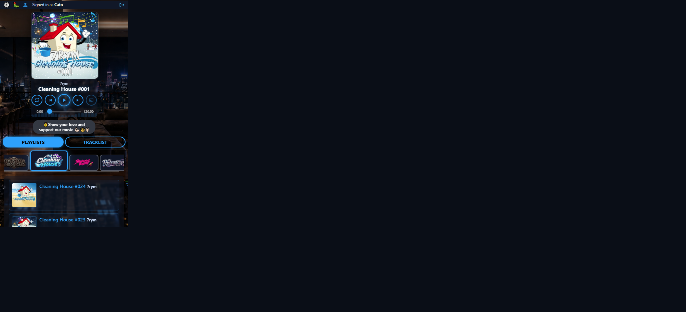
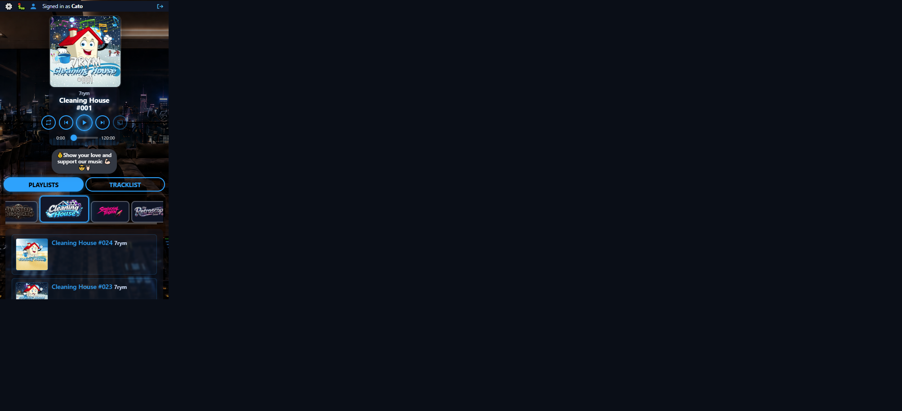
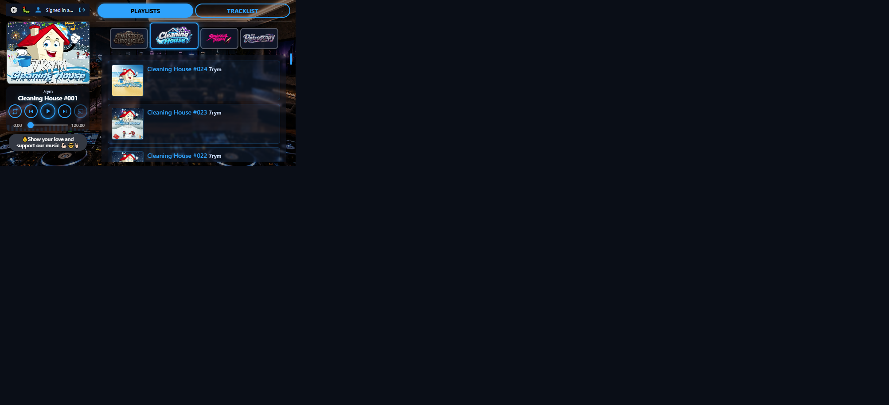
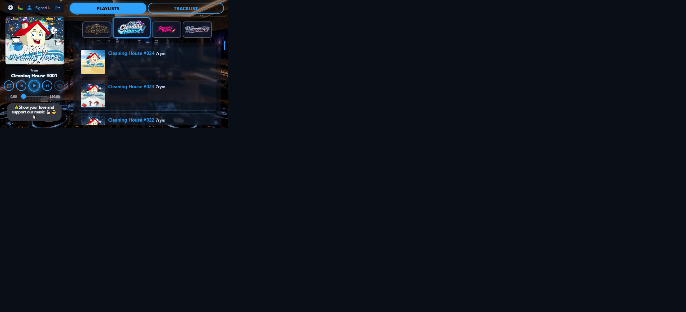
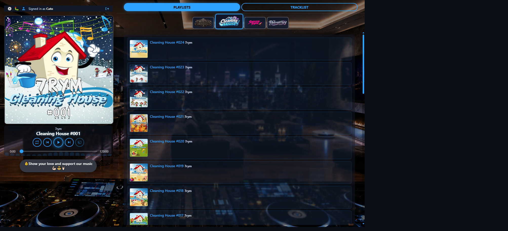
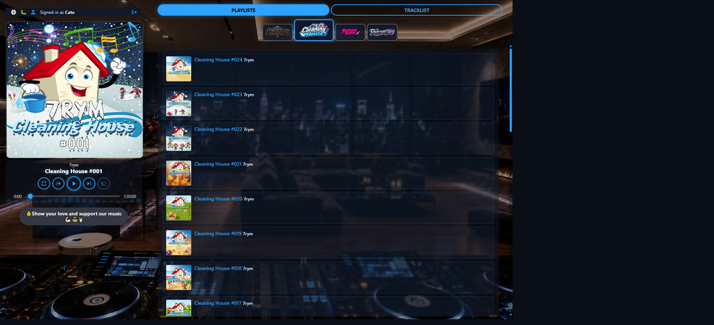
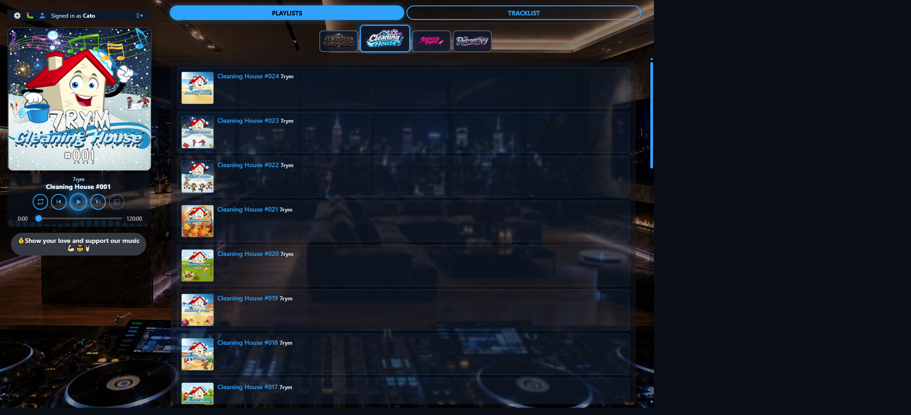

# Player size visual audit — round 3 (18 Oct 2026)

**Host:** local `http://127.0.0.1:8000/play` (Cleaning House)  
**Compared to:** [round 2 report](../player-size-2026-10-18-r2/REPORT.md)  
**Changes in this round:** stacked user strip spans full viewport (not cover rail); short landscape gap + no strip/cover overlap; desktop strip top-left with clear separation (reverted whole-rail vertical centre).

**Scales under test** (unchanged from r2)

| Preset | Stacked | Split (desktop) | Short landscape |
|--------|--------:|----------------:|----------------:|
| Large  | 0.62    | 1.0             | 1.0             |
| Normal | 0.52    | 0.9             | 1.0             |
| Small  | 0.42    | 0.75            | 0.92            |

**Capture caveat:** Cursor letterboxes emulated phone viewports inside a wider frame. Judge chrome *inside* the content box; trust measured widths/gaps.

**Missing frame:** Short-landscape **Normal** = same short scale as Large (`1.0`) — not captured separately.

### Scorecard (operator-aligned)

| Mode | Large | Normal | Small |
|------|-------|--------|-------|
| Stacked portrait | **Pass** | **Pass** | **Pass** |
| Short landscape | **Pass** | **Pass** (= Large) | **Pass** |
| Desktop split | **Pass** | **Pass** | **Pass** |

---

## 1. Stacked portrait (375×667)

### Round-3 fix

`#mediaplayer` is full viewport width; cover / scene stay on `--player-rail`; `#player-user-area` stretches edge-to-edge.

### 1.1 Large — `r3-stacked-large.png`

| Measure | Value |
|---------|------:|
| User strip width | **375px** (full viewport) |
| Cover | ~233×233 (scale 0.62) |
| Strip wider than cover | **+139px** |
| Gap strip → scene | **8px** |
| Content peek | **~234px** |
| First list row above fold | **Yes** (`#024`) |
| Overlap strip/cover | None |

**Fair evaluation:** **Pass.** Strip no longer shares the cover rail; tools + “Signed in as…” have the full phone width.

---

### 1.2 Normal — `r3-stacked-normal.png`

| Measure | Value |
|---------|------:|
| User strip | **375px** |
| Cover | ~195px (scale 0.52) |
| Strip vs cover | **+176px** |
| Content peek | **~272px** |
| First rows above fold | **Yes** (#024, #023) |

**Fair evaluation:** **Pass.**

---

### 1.3 Small — `r3-stacked-small.png`

| Measure | Value |
|---------|------:|
| User strip | **375px** |
| Cover | ~158px (scale 0.42) |
| Strip vs cover | **+214px** |
| Content peek | **~295px** |
| First rows above fold | **Yes** |

**Fair evaluation:** **Pass.** Narrowest cover; widest strip-vs-cover gain; playlist presence obvious.

---

## 2. Short landscape (667×375)

### Round-3 fix

Clear margin under the user strip (10px), scene `overflow: hidden` + capped height so art cannot paint over the strip; measured gap **10px**, overlap **none**.

### 2.1 Large — `r3-short-large.png`

| Measure | Value |
|---------|------:|
| Rail / scene | ~200 / ~188 |
| User strip height | ~29px (single line, icon logout) |
| Gap strip → scene | **10px** |
| Overlap | **None** (−10px) |
| Title/control overlap | No |

**Fair evaluation:** **Pass.** Addresses r2 “strip overlaps artwork” (flush / colliding).

---

### 2.2 Normal — (equiv. Large short scale)

Short scale `1.0` — same geometry as §2.1.

**Fair evaluation:** **Pass.**

---

### 2.3 Small — `r3-short-small.png`

| Measure | Value |
|---------|------:|
| Rail / scene | ~184 / ~172 |
| Gap strip → scene | **10px** |
| Overlap | **None** |
| User strip | Single line, icon logout |

**Fair evaluation:** **Pass.**

---

## 3. Desktop split (1440×900)

### Round-3 fix

Reverted `justify-content: safe center` → **`flex-start`**. User strip stays **top-left** of the rail with **14px** margin below before the cover.

### 3.1 Large — `r3-desktop-large.png`

| Measure | Value |
|---------|------:|
| `#mediaplayer` justify | **flex-start** |
| User strip top | **~22px** (rail padding) |
| Gap strip → scene | **14px** |
| Cover | ~433px |
| Title/control overlap | No |

**Fair evaluation:** **Pass.** Top-left strip, clearly separated from artwork; rest of the r2 desktop win kept.

---

### 3.2 Normal — `r3-desktop-normal.png`

| Measure | Value |
|---------|------:|
| justify | flex-start |
| Gap strip → scene | **14px** |
| Cover | ~387px (scale 0.9) |

**Fair evaluation:** **Pass.**

---

### 3.3 Small — `r3-desktop-small.png`

| Measure | Value |
|---------|------:|
| justify | flex-start |
| Gap strip → scene | **14px** |
| Cover | ~318px (scale 0.75) |

**Fair evaluation:** **Pass.**

---

## Cross-cutting

1. **Stacked full-width strip** — measured `#player-user-area` / `.player-user-status` = viewport width; cover remains scaled and centred (Large +139px, Normal +176px, Small +214px wider strip than cover).
2. **Short landscape** — 10px gap; no geometric overlap; icon logout keeps the strip single-line.
3. **Desktop** — strip top-left again; 14px separation from cover; no vertical centring of the whole chrome stack.
4. Letterboxing on phone PNGs remains a Cursor capture artefact.
5. Local audio may still show “not ready”; chrome judged independently.

## Verdict

Operator notes from round 2 are addressed. Round-3 matrix is **Pass** across stacked / short / desktop. Ready for checkpoint when you want it.
