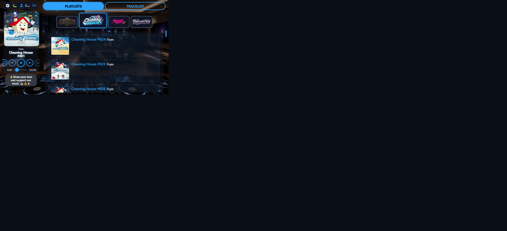

# Player size visual audit — round 4 short landscape (18 Oct 2026)

**Host:** local `http://127.0.0.1:8000/play` (Cleaning House)  
**Focus:** Short landscape only (667×375) — operator feedback from r3  
**Compared to:** [round 3 report](../player-size-2026-10-18-r3/REPORT.md)

### Changes in this round

1. **One size for short landscape** — Branding Large|Normal|Small no longer change short geometry (`--cover-size-scale: 1` + fixed height-led `--card-size`).
2. **No artwork clip** — removed `max-height` / `overflow: hidden` on `.scene`; full **square** cover via card-size budget only.
3. **Username-only strip** — dropped “Signed in as” / “Logged in as”; name trails the user icon (everywhere).
4. **Beggars wraps** — support button `white-space: normal`, `width: 100%` of rail so multi-line (Chrome-like) is always possible.

### Scorecard

| Check | Result |
|-------|--------|
| Single short geometry (L/N/S identical) | **Pass** (cover 142×142 for all three injected presets) |
| Cover square, not clipped | **Pass** (`aspect` 1.0; `max-height: none`; `overflow: visible`) |
| Strip / cover overlap | **None** (gap **8px**) |
| “Signed in as” removed | **Pass** (status shows tools + **Cato**) |
| Beggars multi-line | **Pass** (~49px ≈ 2–3 lines; `white-space: normal`) |
| Stack fits viewport without scroll | **Pass** |

---

## Short landscape — `r4-short.png`

| Measure | Value |
|---------|------:|
| Viewport | 667×375 |
| Cover | **142×142** (square) |
| Scene overflow / max-height | visible / none |
| User strip → scene gap | **8px** |
| Username | **Cato** (no “Signed in as”) |
| Support button height | ~49px (wraps) |
| `#mediaplayer` scroll needed | No |
| Player size L vs N vs S cover | 142 / 142 / 142 |

**Comments**

- Scarce resource is height; one compact square + compact transport + wrapping beggars fits without painting over the strip or clipping the art.
- Rail is intentionally narrow (~138–150px); username ellipsizes if longer than “Cato”, but the label prefix is gone so short names read cleanly.
- Capture letterboxing remains a Cursor artefact — trust the measures above.

**Fair evaluation:** **Pass** for the short-landscape brief.

---

## Unchanged (r3 still stands)

Stacked full-width strip and desktop top-left + separation were not reopened this round.

## Verdict

Short landscape is simplified to **one platform size**, with a full square cover (no clip), username-only strip, and wrapping Beggars. Ready for checkpoint when you want it.
