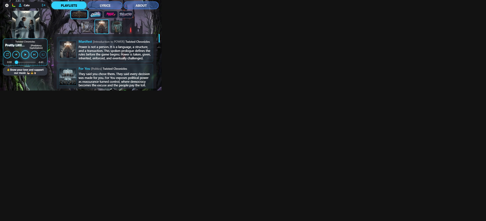

# Player size visual audit — round 6 short / Twisted Chronicles (18 Oct 2026)

**Host:** local `http://127.0.0.1:8000/play/twisted-chronicles/power/pretty-little-prole`  
**Viewport:** 667×375 short landscape  
**Compared to:** [round 5 report](../player-size-2026-10-18-r5/REPORT.md)

### Changes in this round

1. **Transport + Beggars fill the rail** — `width: 100%` / `max-width: none` after stacked mobile overrides; beggars padding cleared so the support button matches the rail (184px with strip/transport).
2. **Playlist selector tighter** — campaign logos and coverflow thumbs shrink; scope gap/padding cut (scope ~100px tall vs prior ~112+ with larger thumbs).
3. Audited on **Pretty Little Prole** (longer title + version) instead of Cleaning House.

### Scorecard

| Check | Result |
|-------|--------|
| Track | Pretty Little Prole — Twisted Chronicles / POWER |
| User / transport / beggars / support width | **184 / 184 / 184 / 184** |
| Five controls inside transport | **Pass** |
| Cover square (not clipped) | **Pass** (~117×117) |
| Campaign strip height | **~38px** |
| Coverflow height | **~60px** (thumbs 48 / active 56) |
| Playlist scope total height | **~100px** |

---

## Short landscape — `r6-short-twisted.png`

| Measure | Value |
|---------|------:|
| Title / artist | Pretty Little Prole / Twisted Chronicles |
| Rail content width | **184px** (strip = transport = beggars = support) |
| Cover | ~117×117, centred on rail |
| Transport height | ~113px |
| Playlist scope (campaign + coverflow) | ~100px |
| Username | Cato (no “Signed in as”) |

**Comments**

- Transport and beggars now match the user-strip rail width (cover may stay slightly narrower/centred — chrome uses the full column).
- Playlist/campaign artwork uses less vertical budget so more of the track list shows above the fold.
- Long titles still ellipsis in the narrow rail (expected).

**Fair evaluation:** **Pass** for the r6 brief.

## Verdict

Short landscape on Twisted Chronicles: full-rail transport/beggars, tighter playlist selector, controls still unclipped. Ready for checkpoint when you want it.
