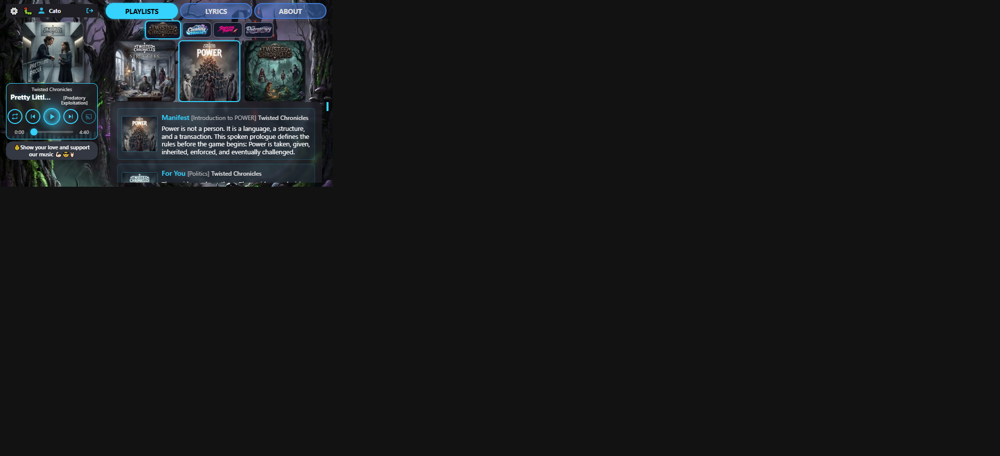

# Player size visual audit — round 7 short / Twisted Chronicles (18 Oct 2026)

**Host:** local `http://127.0.0.1:8000/play/twisted-chronicles/power/pretty-little-prole`  
**Viewport:** 667×375 short landscape  
**Compared to:** [round 6 report](../player-size-2026-10-18-r6/REPORT.md)

### Changes in this round

1. **Coverflow thumbs 120×120** — active and unselected share the same CSS size (no active bump).
2. **Unselected coverflow opacity = 1** — translucent side thumbs removed so living shell backgrounds no longer show through.
3. **Short `--card-size` floor 120px** — `clamp(120px, min(28vw, 32dvh), 140px)` so the rail cover stays at least as large as the coverflow thumbs.

### Scorecard

| Check | Result |
|-------|--------|
| Track | Pretty Little Prole — Twisted Chronicles / POWER |
| User / transport / beggars width | **184 / 184 / 184** |
| Five controls inside transport | **Pass** |
| Coverflow thumb CSS | **120×120** (layout ~124 at dpr 2) |
| Coverflow item opacity | **1** (active + unselected) |
| Cover square (not clipped) | **Pass** (~124×124) |
| Playlist scope total height | **~164px** (coverflow ~124px) |

---

## Short landscape — `r7-short-twisted.png`

| Measure | Value |
|---------|------:|
| Title / artist | Pretty Little Prole / Twisted Chronicles |
| Rail content width | **184px** (strip = transport = beggars) |
| Cover | ~124×124, centred on rail |
| Coverflow thumbs | CSS **120×120**, opacity **1** |
| Transport height | ~113px |
| Playlist scope (campaign + coverflow) | ~164px |
| Username | Cato (no “Signed in as”) |

**Comments**

- Side coverflow art is fully opaque at 120×120; POWER (active) keeps the cyan border only.
- Larger coverflow uses more of the content column height; Manifest / For You still visible below.
- Cursor browser may letterbox the 667×375 frame on a larger canvas — treat measures from CDP, not the black margins.

**Fair evaluation:** **Pass** for the r7 brief (120×120 opaque coverflow + short Twisted check).

## Verdict

Short landscape on Twisted Chronicles: coverflow artwork at 120×120 with no unselected fade; rail chrome still aligned; controls unclipped. Ready for checkpoint when you want it.
