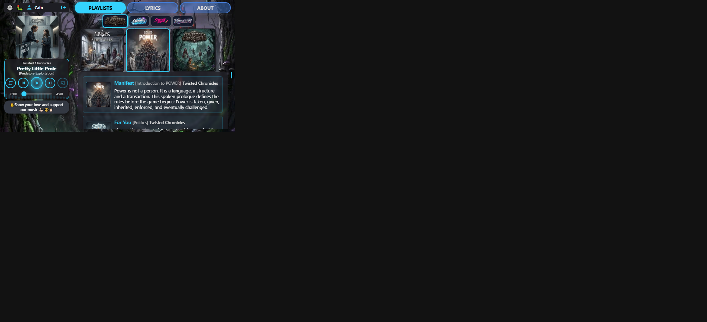

# Player size visual audit — round 8 short / Twisted Chronicles (18 Oct 2026)

**Host:** local `http://127.0.0.1:8000/play/twisted-chronicles/power/pretty-little-prole`  
**Viewport:** 667×375 short landscape  
**Compared to:** [round 7 report](../player-size-2026-10-18-r7/REPORT.md)

### Changes in this round

1. **Version under title** — `.track-headline` is a column (`flex-direction: column`) so `#songVersion` stacks under `#songTitle` instead of sitting on the same baseline row.
2. Branding Live preview headline matches (`theme-preview-track-headline`).
3. Short landscape: version also ellipsises if it outruns the rail.

### Scorecard

| Check | Result |
|-------|--------|
| Track | Pretty Little Prole — Twisted Chronicles / POWER |
| Title / version stack | **Pass** — version top ≥ title bottom |
| Title text (no side-by-side crush) | **Pretty Little Prole** (full) |
| Version text | **[Predatory Exploitation]** |
| User / transport / beggars width | **184 / 184 / 184** |
| Five controls inside transport | **Pass** |
| Transport height | **~115px** (+~2px vs r7) |
| Coverflow thumbs | **120×120**, opacity **1** |

---

## Short landscape — `r8-short-twisted.png`

| Measure | Value |
|---------|------:|
| Artist → Title → Version | Twisted Chronicles → Pretty Little Prole → [Predatory Exploitation] |
| Headline flex | **column** (~26px tall) |
| Rail content width | **184px** |
| Cover | ~124×124 |
| Coverflow thumbs | CSS 120×120, opacity 1 |

**Comments**

- Side-by-side title+version was the reason long titles truncated to `Pretty Littl…` while the version fought for the same row. Stacking frees the title line; version reads as secondary under it.
- Transport grew only ~2px — still fits short height with cover + beggars.

**Fair evaluation:** **Pass** for the r8 brief.

## Verdict

Short landscape on Twisted Chronicles: title/version stack reads cleanly; rail chrome and 120×120 coverflow hold. Good candidate for a final Player-size checkpoint unless you want one more tweak.
