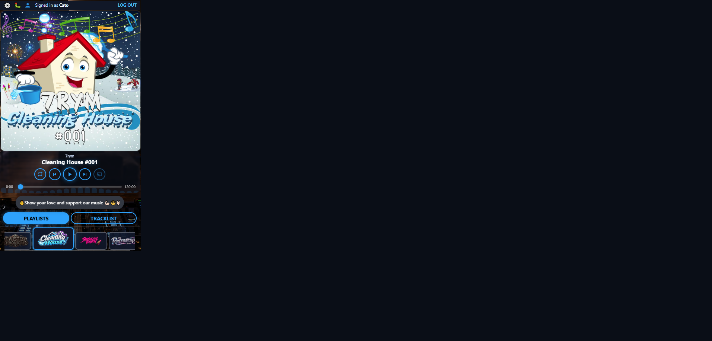
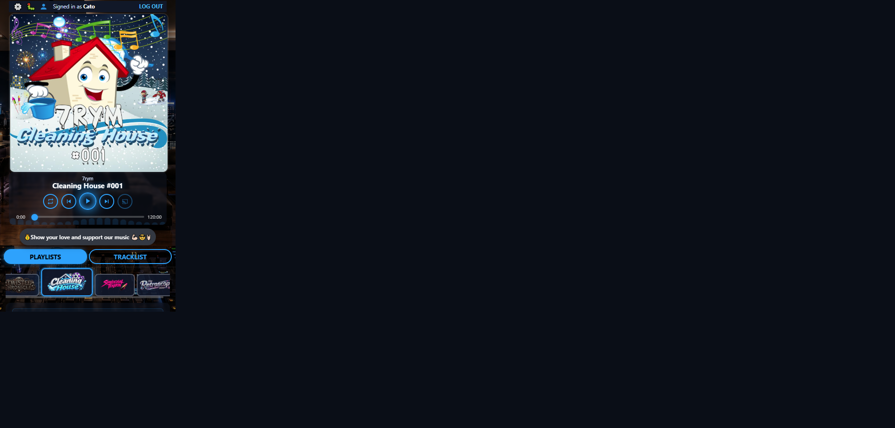
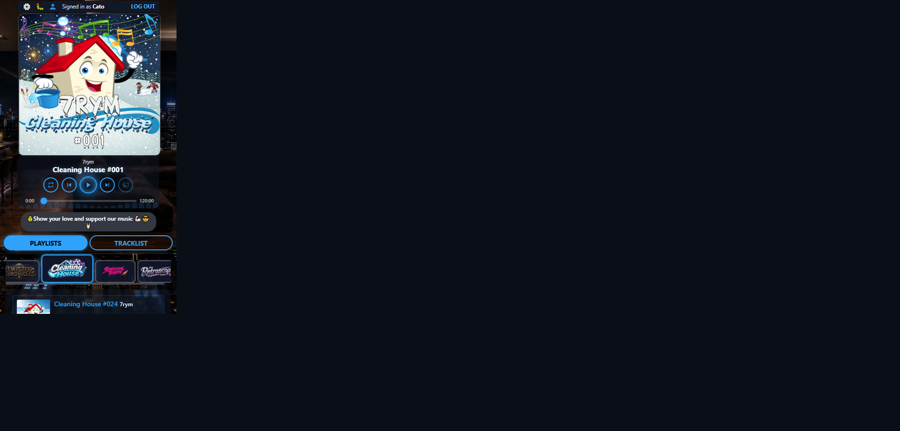
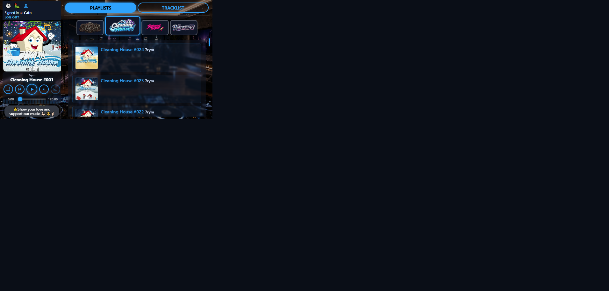
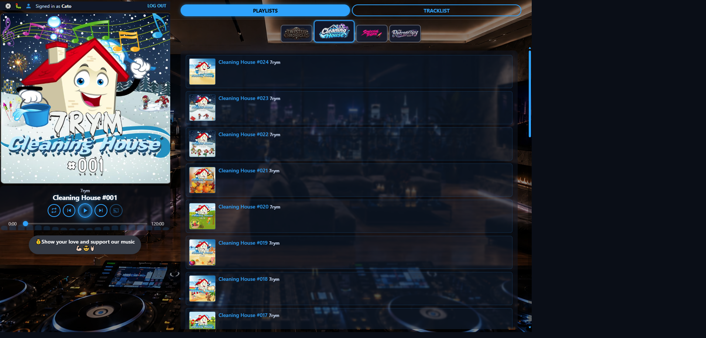
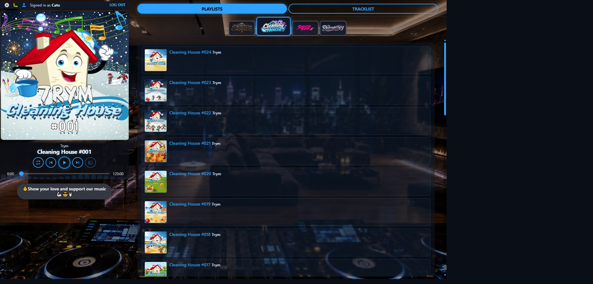
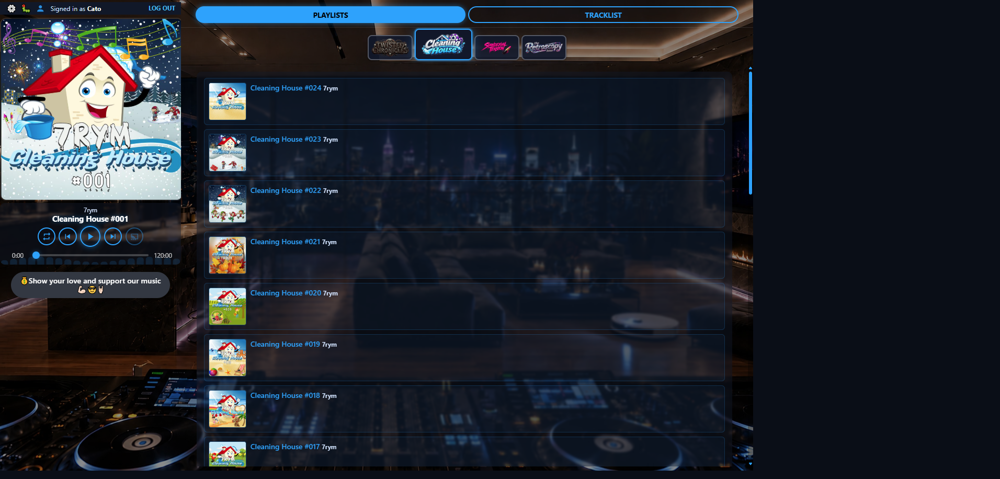

# Player size visual audit — 18 Oct 2026

**Host:** local `http://127.0.0.1:8000/play` (Cleaning House)  
**Method:** inject `--player-size-scale-*` per preset; emulate viewports via CDP; screenshot + geometry measures  
**Scales under test:**

| Preset | Stacked | Split (desktop) | Short landscape |
|--------|--------:|----------------:|----------------:|
| Large  | 1.0     | 1.0             | 1.0             |
| Normal | 0.9     | 0.9             | 1.0             |
| Small  | 0.8     | 0.75            | 0.92            |

**Capture caveat:** Cursor’s browser tool letterboxes the emulated phone viewport inside a wider capture frame. Stacked/short PNGs therefore show a dark void around the real UI. That void is **not** a product layout bug — judge the chrome *inside* the content box, and trust the measured widths/heights listed with each image.

**Missing frame:** Short-landscape **Normal** was not saved separately (short scale = Large’s `1.0`, so it matches Short Large).

**Overall scorecard**

| Mode | Large | Normal | Small |
|------|-------|--------|-------|
| Stacked portrait | Pass | Pass | Pass |
| Short landscape | Pass (tight) | Pass (same as Large) | Pass* |
| Desktop split | Pass | Pass | Pass |

\*Short Small: usable, user strip wraps more.

---

## 1. Stacked portrait (iPhone SE 375×667)

### 1.1 Large — `audit-stacked-large.png`

| Measure | Value |
|---------|------:|
| Cover / scene | 375×375 |
| Transport height | ~113px |
| Title vs controls overlap | No |
| Cover scale applied | 1.0 |

**Comments**

- Cover fills the phone width (the earlier “could be filling” ask).
- Title sits clearly above the control row; scrubber below — the old 4:1 crush is gone.
- User strip, Beggars banquet, and Playlists/Tracklist remain readable in the first scroll.

**Fair evaluation:** **Pass.** This is the stacked Large we wanted after the transport fix. Residual nit: five control buttons are still compact on a phone, but they are distinct tap targets and no longer overlapping.

---

### 1.2 Normal — `audit-stacked-normal.png`

| Measure | Value |
|---------|------:|
| Cover / scene | ~338×338 |
| Transport height | ~113px |
| Title vs controls overlap | No |
| Cover scale applied | 0.9 |

**Comments**

- Modest step down from Large; side slack appears beside the cover (expected for 0.9).
- Transport stack still healthy; no title/control collision.
- Content chrome below the player remains usable.

**Fair evaluation:** **Pass.** Acceptable mid step. Looks slightly “narrower column” than Large inside the phone frame — intentional, not broken.

---

### 1.3 Small — `audit-stacked-small.png`

| Measure | Value |
|---------|------:|
| Cover / scene | ~300×300 |
| Rail width | ~300 |
| Transport height | ~113px |
| Title vs controls overlap | No |
| Cover scale applied | 0.8 |

**Comments**

- Smallest stacked footprint that still keeps transport natural height.
- More first-screen room for content tabs / campaign strip.
- Controls remain separated; hit targets slightly tighter than Normal.

**Fair evaluation:** **Pass.** Best of the three for “give content more room” without returning to the destroyed transport.

---

## 2. Short landscape / wide phone (667×375)

### 2.1 Large — `audit-short-large.png`

| Measure | Value |
|---------|------:|
| Body grid | ~200px + ~443px |
| Cover (capped) | ~200×158 |
| Transport height | ~102px |
| Title vs controls overlap | No |
| Button-to-button overlap | No |
| Cover scale applied | 1.0 (short tier) |

**Comments**

- True split: player left, content right — matches the phone-on-stand contract.
- Cover yields via `max-height` so transport can breathe; title no longer sits on play/pause.
- User strip wraps (“Signed in as…” / Log out) — cramped but on-screen (earlier shots clipped Log out).
- Control buttons ~30px with gaps — small but not colliding.

**Fair evaluation:** **Pass (tight).** Night-and-day vs the destroyed short-landscape shot from before the fix. Remaining polish: user-area density and slightly wider rail if we want luxury, not a blocker.

---

### 2.2 Normal — (not captured; same short scale as Large)

Short scale for Normal is **1.0**, identical to Large. Geometry matches §2.1.

**Fair evaluation:** **Pass** (by equivalence).

---

### 2.3 Small — `audit-short-small.png`

| Measure | Value |
|---------|------:|
| Body grid | ~184px + ~459px |
| Cover | ~184×158 |
| Transport height | ~102px |
| User strip height | ~59px (more wrap) |
| Title vs controls overlap | No |
| Cover scale applied | 0.92 |

**Comments**

- Narrower rail than Large (~184 vs ~200); content column gains a little.
- User strip wraps more aggressively — still complete, less elegant.
- Transport stack still intact (natural height).

**Fair evaluation:** **Pass\*.** Usable listening chrome. Lowest comfort of the short-landscape set; if operators complain here, bump short Small toward 1.0 or compact the user strip to a single line.

---

## 3. Desktop split (1440×900)

### 3.1 Large — `audit-desktop-large.png`

| Measure | Value |
|---------|------:|
| Rail / scene | ~461px |
| Transport height | ~122px |
| Title vs controls overlap | No |
| Cover scale applied | 1.0 |

**Comments**

- Full-card Large template: cover and transport share a substantial left rail (~32% of 1440).
- Title → controls → scrubber hierarchy is clear; Beggars banquet readable.
- Content column (Playlists / campaign strip / list) has room to work.
- Capture may show a dark margin outside the emulated 1440 box — ignore for product scoring.

**Fair evaluation:** **Pass.** Strong desktop Large. This is the reference the Normal/Small steps should orbit.

---

### 3.2 Normal — `audit-desktop-normal.png`

| Measure | Value |
|---------|------:|
| Rail / scene | ~415px |
| Transport height | ~122px |
| Title vs controls overlap | No |
| Cover scale applied | 0.9 |

**Comments**

- Clear step down from Large (~461 → ~415) without collapsing into the old “tiny rail” defect (~336px era).
- Controls remain distinct; track info fully above them.
- Content column grows as intended.

**Fair evaluation:** **Pass.** Fair mid preset — smaller than Large, still a proper desktop player column.

---

### 3.3 Small — `audit-desktop-small.png`

| Measure | Value |
|---------|------:|
| Rail / scene | ~346px |
| Transport height | ~118px |
| Title vs controls overlap | No |
| Cover scale applied | 0.75 |

**Comments**

- Narrowest desktop rail in the set, but transport height stays healthy (~118px).
- No title/control crush; buttons remain spaced.
- Maximises content width — correct job for Small.
- Feels compact next to Large; that is the point, not a regression to the unreadable 0.5/0.6 era.

**Fair evaluation:** **Pass.** Acceptable compact desktop. If fleet feedback prefers Small closer to Normal, nudge split Small from 0.75 → ~0.82 later — not required to call this audit green.

---

## Cross-cutting notes

1. **Transport natural height** is the real win. Measured overlap = false in every captured cell; that was the SE portrait/landscape destroyer.
2. **Letterboxing in PNGs** is a capture artefact for emulated phones. Product layout uses the measured viewport (stacked fills 375; short splits ~200+443).
3. **Local audio** showed “Music isn't ready” in the a11y tree during the run; artwork/chrome still rendered for layout judgement.
4. **Not re-tested here:** real device Safari/Chrome, Branding Live preview remirror, locked brand documents (injection only).

## Verdict

The nine-cell matrix (with Normal short = Large short) is **fairly Pass** after the mobile transport uncrush + mode-aware scales. Remaining work is polish (short-landscape user strip, optional Small bumps), not another emergency layout rewrite.
