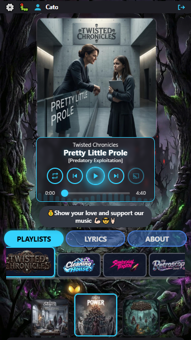
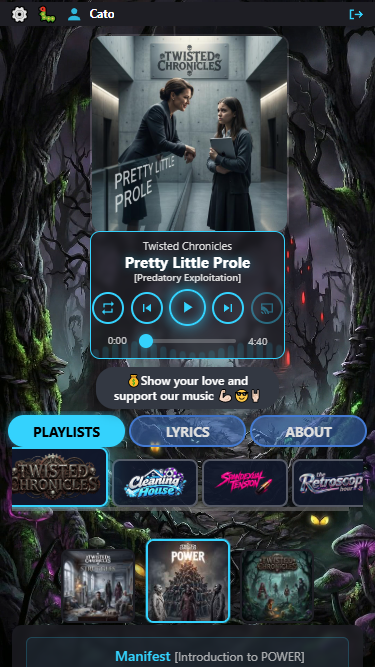
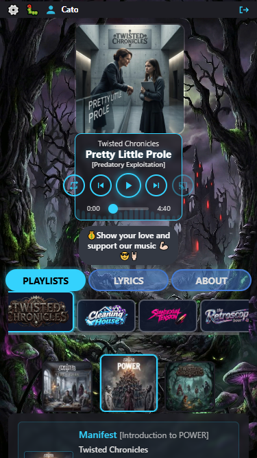
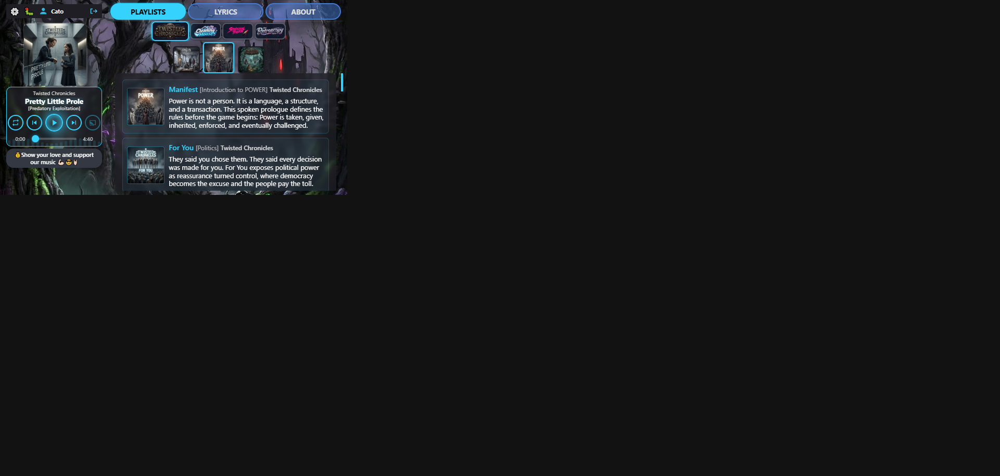
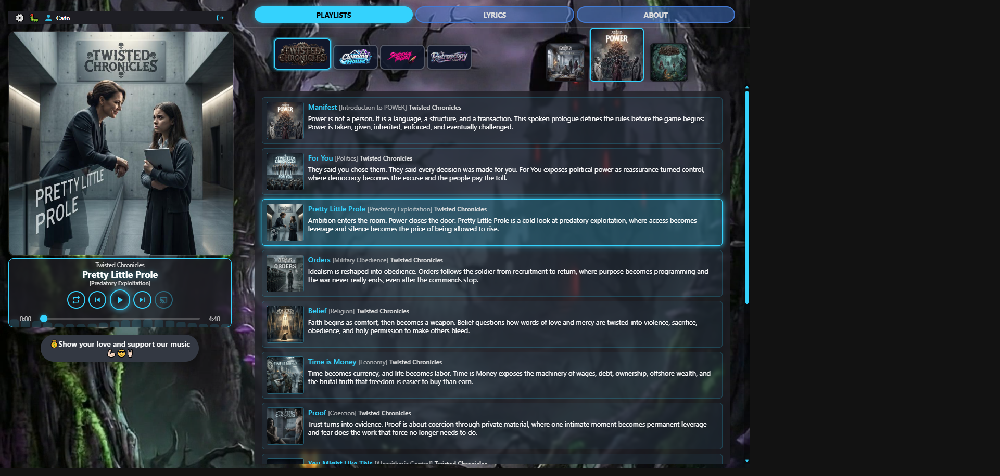
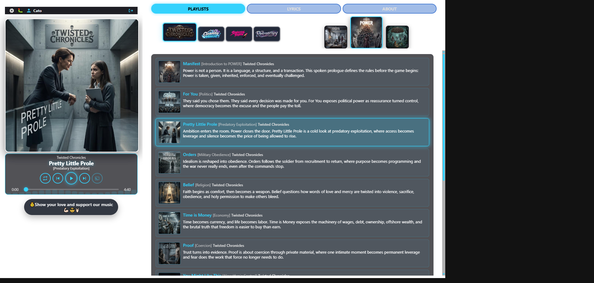
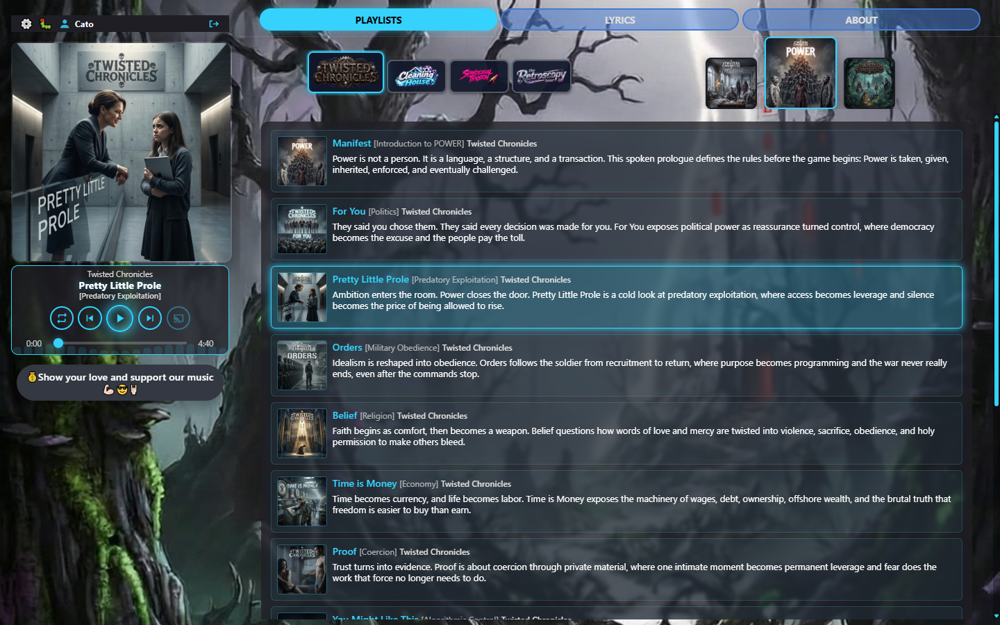

# Player size visual audit — round 9 full matrix (19 Oct 2026)

**Host:** local `http://127.0.0.1:8000/play/twisted-chronicles/power/pretty-little-prole`  
**Compared to:** [round 3 full matrix](../player-size-2026-10-18-r3/REPORT.md) + [round 8 short](../player-size-2026-10-18-r8/REPORT.md)  
**Why this round:** Confirm playlist-selector artwork after restoring compact thumbs; version-under-title; rail cover floor; full view-mode matrix.

### Corrections after first publish of this folder

1. **Stacked PNGs were broken** — earlier files were double-height composites (two UIs in one image, 750×1334). Replaced with clipped **375×667** CDP captures.
2. **Coverflow blown up on stacked** — `player.js` stamped HTML `width`/`height` **100/70** on coverflow thumbs, fighting CSS (70/80). Removed; sizes are CSS-owned again.
3. **Tabs → selector air** — stacked content-toggle bottom padding/border removed (gap **0px**).
4. **Desktop Small §3.3** — replaced bad Cursor letterbox composite with true **1440×900** CDP PNG.

**Scales under test**

| Preset | Stacked | Split (desktop) | Short landscape |
|--------|--------:|----------------:|----------------:|
| Large  | 0.62    | 1.0             | *(one size)*    |
| Normal | 0.52    | 0.9             | *(one size)*    |
| Small  | 0.42    | 0.75            | *(one size)*    |

**Capture note:** Use CDP `Page.captureScreenshot` with an explicit `clip` at the emulated size. Avoid Cursor `browser_take_screenshot` for report plates (letterboxes ~1921×916).

**Playlist selector contract**

| Mode | Unselected | Active | Opacity |
|------|-----------:|-------:|---------|
| Stacked / default | **70×70** | **80×80** | **1** |
| Desktop split | **70×70** | **100×100** | **1** |
| Short landscape | **48×48** | **56×56** | **1** |

### Scorecard

| Mode | Large | Normal | Small |
|------|-------|--------|-------|
| Stacked portrait (375×667) | **Pass*** | **Pass** | **Caution** |
| Short landscape (667×375) | **Pass** (one size) | = | = |
| Desktop split (1440×900) | **Pass** | **Pass** | **Pass** |

\*On Twisted (campaign strip + coverflow), stacked Large’s content peek is mostly the selector; first track may sit at/under the fold.

---

## 1. Stacked portrait (375×667)

Plates are **375×667** (single viewport). Coverflow thumbs **70 / 80**. Tabs flush to selector.

### 1.1 Large — `r9-stacked-large.png`

| Measure | Value |
|---------|------:|
| Capture | **375×667** |
| User strip | **375px** full width |
| Cover | ~236×236 (scale 0.62) |
| Gap strip → scene | **8px** |
| Gap tabs → campaign logos | **0px** |
| Coverflow thumbs | **70 / 80**, opacity **1** |
| Version under title | **Yes** |
| Five controls inside transport | **Yes** |
| Campaign + coverflow visible | **Yes** |

**Fair evaluation:** **Pass.**

---

### 1.2 Normal — `r9-stacked-normal.png`

| Measure | Value |
|---------|------:|
| Capture | **375×667** |
| Cover | ~199×199 (scale 0.52) |
| Coverflow thumbs | **70 / 80** |
| Gap tabs → campaign | **0px** |
| Version under title | **Yes** |

**Fair evaluation:** **Pass.**

---

### 1.3 Small — `r9-stacked-small.png`

| Measure | Value |
|---------|------:|
| Capture | **375×667** |
| Cover | ~161×161 (scale 0.42) |
| Transport width | **~158px** |
| Five controls inside transport | **No** — outer buttons overhang |
| Coverflow thumbs | **70 / 80** |
| Version under title | **Yes** |

**Fair evaluation:** **Caution** (transport packing only — not selector artwork).

---

## 2. Short landscape (667×375) — one platform size

### 2.1 Platform short — `r9-short.png`

| Measure | Value |
|---------|------:|
| Rail / strip / transport / beggars | **184 / 184 / 184 / 184** |
| Cover | ~124×124 (≥120 floor) |
| Coverflow thumbs | **48 / 56**, opacity **1** |
| Playlist scope height | **~100px** |
| Version under title | **Yes** |
| Five controls inside transport | **Yes** |

**Fair evaluation:** **Pass.**

---

## 3. Desktop split (1440×900)

### 3.1 Large — `r9-desktop-large.png`

| Measure | Value |
|---------|------:|
| Gap strip → scene | **14px** |
| Cover | ~433×433 (scale 1.0) |
| Coverflow thumbs | **70 / 100**, opacity **1** |
| Version under title | **Yes** |

**Fair evaluation:** **Pass.**

---

### 3.2 Normal — `r9-desktop-normal.png`

| Measure | Value |
|---------|------:|
| Cover | ~387×387 (scale 0.9) |
| Coverflow thumbs | **70 / 100** |
| Version under title | **Yes** |

**Fair evaluation:** **Pass.**

---

### 3.3 Small — `r9-desktop-small.png`

| Measure | Value |
|---------|------:|
| Capture | **1440×900** CDP |
| Cover | ~318×318 (scale 0.75) |
| Coverflow thumbs | **70 / 100** |
| Transport | **~314px**, controls inside |
| Scrubber / beggars | **1 / 1** |

**Fair evaluation:** **Pass.**

---

## Cross-cutting

1. **CSS owns coverflow sizes** — do not stamp HTML `width`/`height` from JS (regression that made stacked active thumbs 100px).
2. **Stacked tabs flush to selector** — content-toggle bottom padding/border cleared under 767px / wider stacked.
3. **Unselected opacity 1** — holds in every mode.
4. **Version under title** — holds stacked / short / desktop.
5. **Stacked Small transport overhang** — still open.
6. Local audio may show “not ready”; chrome judged independently.

## Verdict

After fixing broken stacked plates + JS thumb attributes: matrix is **Pass** on short, desktop (all sizes), and stacked Large/Normal. **Caution** on stacked Small transport packing. Playlist-selector artwork matches the compact contract again.
