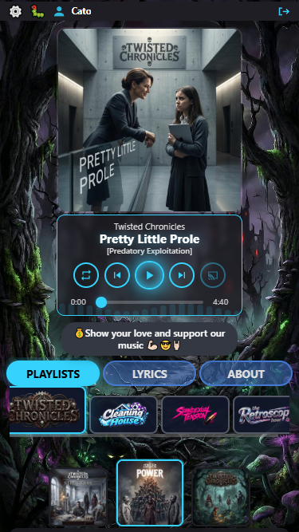
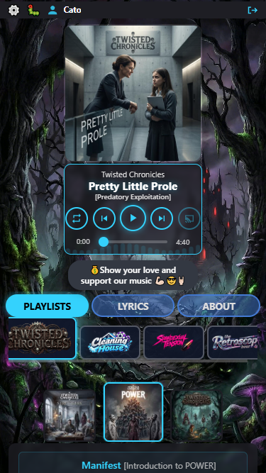
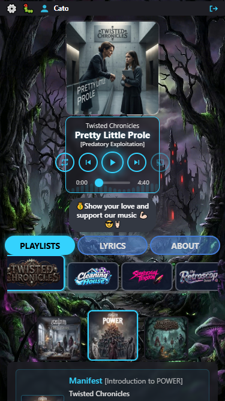
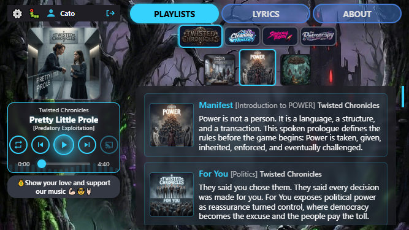
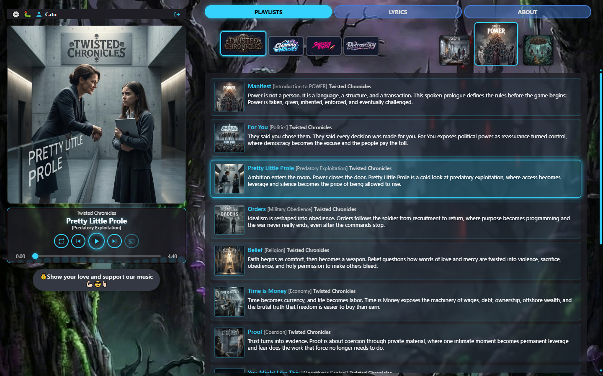
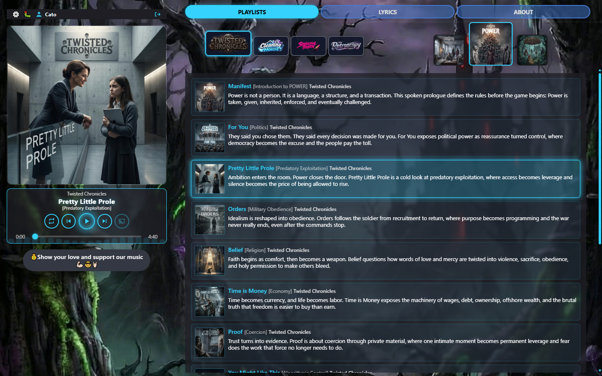
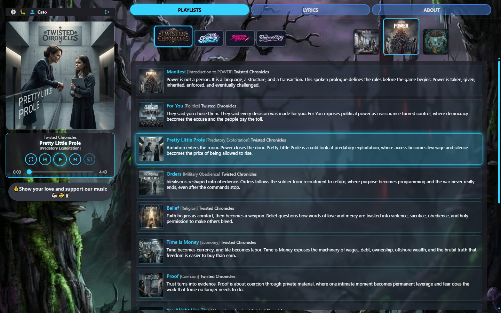

# Player size visual audit — round 10 full matrix (22 Oct 2026)

**Host:** local `http://127.0.0.1:8000/play/twisted-chronicles/power/pretty-little-prole`  
**Track:** Pretty Little Prole `[Predatory Exploitation]` — Twisted Chronicles / POWER  
**Compared to:** [r9](../player-size-2026-10-19-r9/REPORT.md)

### Why redo

r9 stacked plates were unreliable (bad composites / HTML thumb attrs fighting CSS). Round 10 re-shoots the **full matrix on Twisted / Pretty Little Prole only**, with clipped CDP viewports.

### Fixes included in this round

1. **Cover border-box** — `.cover-art` uses `box-sizing: border-box` so the 2px border no longer overlaps the transport (~2px collision gone).
2. **Coverflow sizes CSS-owned** — no HTML `width`/`height` stamps from `player.js` (stacked stays **70 / 80**).
3. **Stable Twisted shell** — living `#shell-bg-video` paused for consistent plates (forest atmosphere is the Twisted brand shell, not a stray asset).

**Scales**

| Preset | Stacked | Split | Short |
|--------|--------:|------:|------:|
| Large  | 0.62    | 1.0   | *(one)* |
| Normal | 0.52    | 0.9   | *(one)* |
| Small  | 0.42    | 0.75  | *(one)* |

**Capture:** CDP `Page.captureScreenshot` + `clip` at emulated size (stacked **375×667**, short **667×375**, desktop **1440×900**).

**Playlist selector**

| Mode | Unselected | Active |
|------|-----------:|-------:|
| Stacked | 70 | 80 |
| Desktop | 70 | 100 |
| Short | 48 | 56 |

### Scorecard

| Mode | Large | Normal | Small |
|------|-------|--------|-------|
| Stacked portrait | **Pass** | **Pass** | **Caution** |
| Short landscape | **Pass** (one size) | = | = |
| Desktop split | **Pass** | **Pass** | **Pass** |

---

## 1. Stacked portrait (375×667)

### 1.1 Large — `r10-stacked-large.png`

| Measure | Value |
|---------|------:|
| Capture | **375×667** |
| Cover | ~232×232 (scale 0.62), **no transport overlap** |
| Coverflow thumbs | **70 / 80** |
| Version under title | **Yes** |
| Five controls inside transport | **Yes** |
| Campaign + POWER coverflow | **Visible** |

**Fair evaluation:** **Pass.**

---

### 1.2 Normal — `r10-stacked-normal.png`

| Measure | Value |
|---------|------:|
| Cover | ~195×195 (scale 0.52) |
| Coverflow thumbs | **70 / 80** |
| Version under title | **Yes** |

**Fair evaluation:** **Pass.**

---

### 1.3 Small — `r10-stacked-small.png`

| Measure | Value |
|---------|------:|
| Cover / transport | ~158×158 / ~158px |
| Five controls inside transport | **No** (overhang) |
| Coverflow thumbs | **70 / 80** |

**Fair evaluation:** **Caution** — transport packing only.

---

## 2. Short landscape (667×375)

### 2.1 — `r10-short.png`

| Measure | Value |
|---------|------:|
| Capture | **667×375** |
| Cover | **120×120** |
| Strip / transport / beggars | **184 / 184 / 184** |
| Coverflow thumbs | **48 / 56** |
| Version under title | **Yes** |
| Five controls inside transport | **Yes** |

**Fair evaluation:** **Pass.**

---

## 3. Desktop split (1440×900)

### 3.1 Large — `r10-desktop-large.png`

| Measure | Value |
|---------|------:|
| Capture | **1440×900** |
| Cover | ~429 (scale 1.0) |
| Gap strip → scene | **14px** |
| Coverflow thumbs | **70 / 100** |

**Fair evaluation:** **Pass.**

---

### 3.2 Normal — `r10-desktop-normal.png`

| Measure | Value |
|---------|------:|
| Cover | ~383 (scale 0.9) |
| Coverflow thumbs | **70 / 100** |

**Fair evaluation:** **Pass.**

---

### 3.3 Small — `r10-desktop-small.png`

| Measure | Value |
|---------|------:|
| Cover / transport | ~314 / ~314 |
| Coverflow thumbs | **70 / 100** |
| Five controls inside transport | **Yes** |

**Fair evaluation:** **Pass.**

---

## Cross-cutting

1. Twisted living shell is the brand atmosphere (paused for plates) — not a wrong/random asset.
2. Cover no longer bleeds into transport on stacked.
3. Selector thumbs match CSS contract in every mode.
4. Stacked Small transport overhang remains the only Caution.

## Verdict

Full Twisted / Pretty Little Prole matrix: **Pass** except stacked Small transport packing (**Caution**). Ready for checkpoint when you want it.
