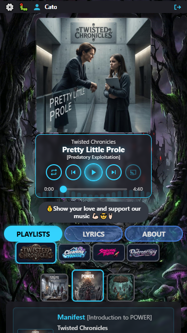
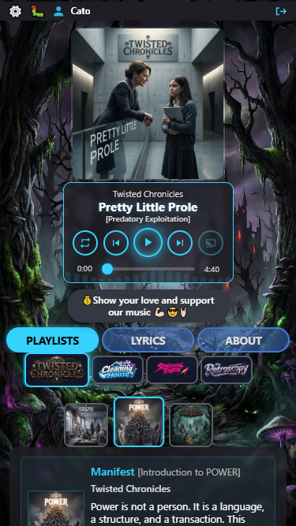
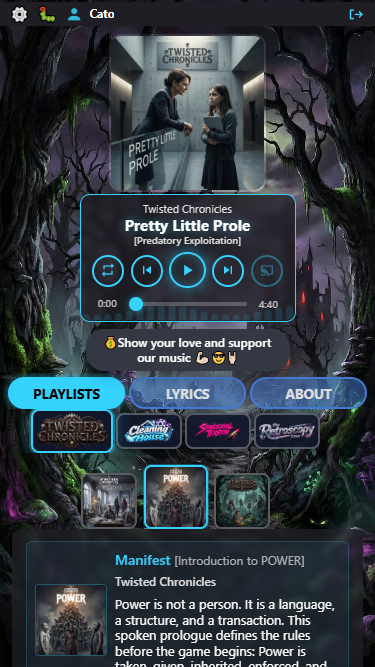
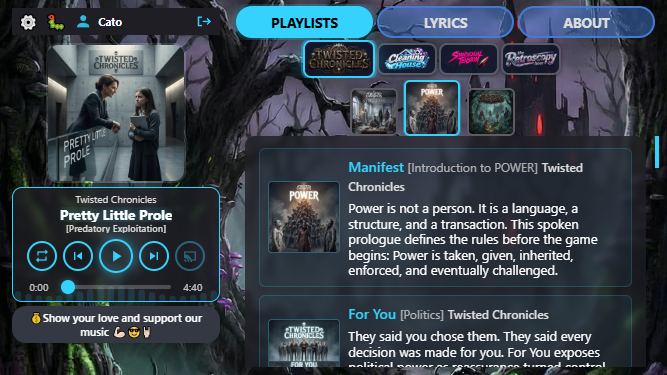
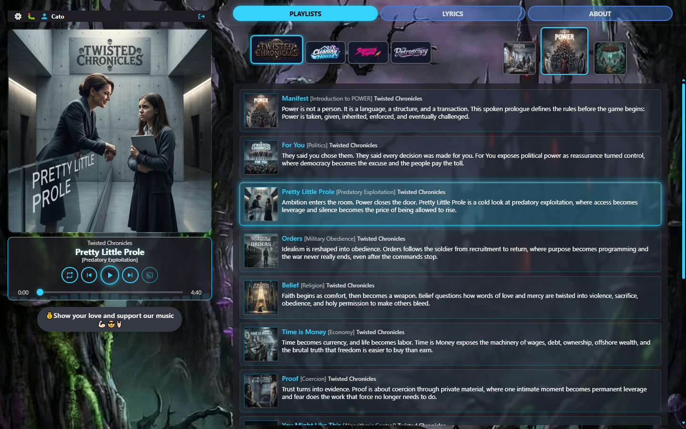
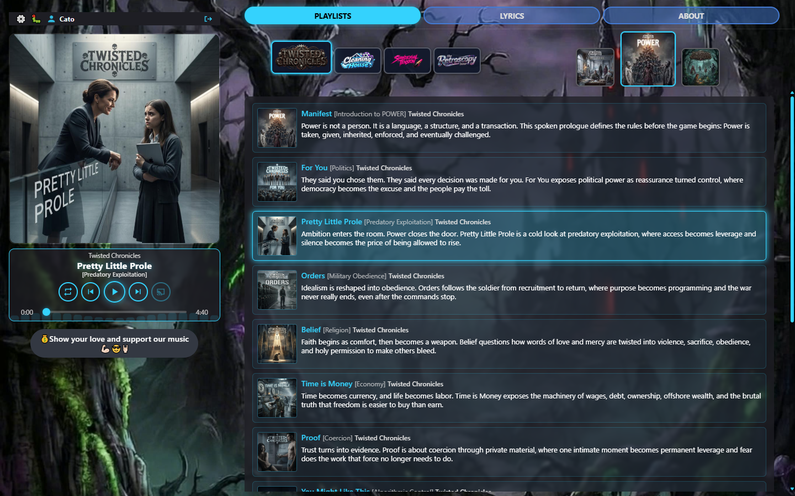
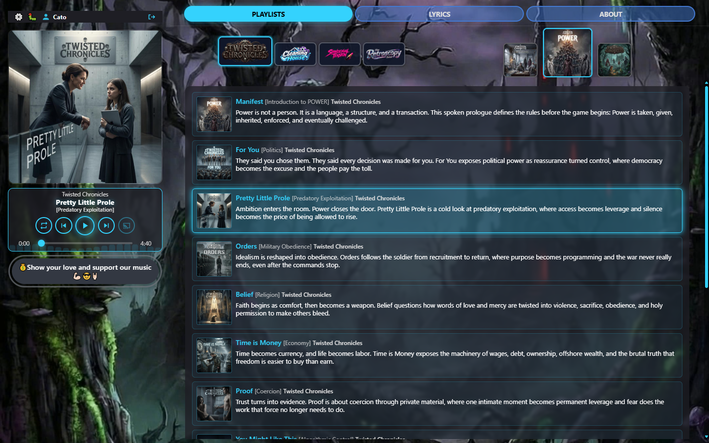
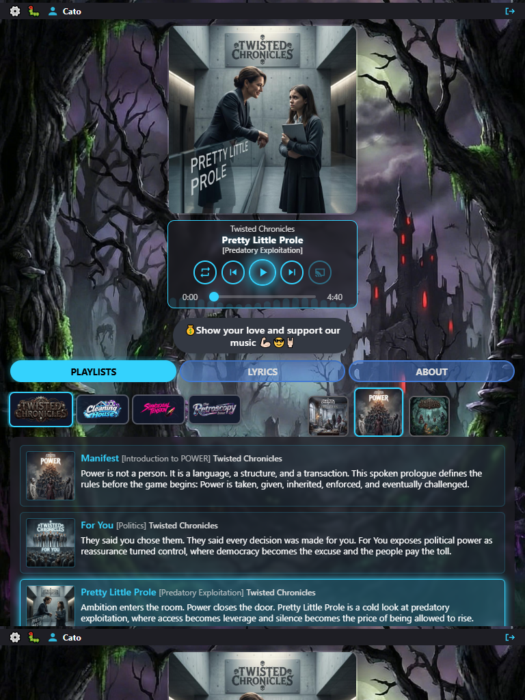

# Player size visual audit — round 11 (22 Oct 2026)

**Host:** local `http://127.0.0.1:8000/play/twisted-chronicles/power/pretty-little-prole`  
**Track:** Pretty Little Prole `[Predatory Exploitation]` — Twisted Chronicles / POWER  
**Compared to:** [r10](../player-size-2026-10-22-r10/REPORT.md)

### Why r10 Pass was wrong

r10 scored stacked Large/Normal as **Pass** on “looks OK / controls mostly fit.” That ignored the locked operator criteria:

| Criterion | r10 reality |
|-----------|-------------|
| First playlist item at least partly visible on every stacked size | Not checked; Large often buried the tracklist under the fold |
| Transport width independent of cover (fit its own content) | Transport tied to `--player-rail` / cover — Small crushed five controls (~158px rail) |
| Beggars width independent of cover | Same rail crush |
| Campaign / playlist selectors compact; selected chip on-screen; overflow cues when scrollable | Centred strip could clip selected TC; no edge-fade; unselected coverflow used transparent borders |
| Short cover ≥ 140×140 | Short still floored at **120** |
| iPad portrait | Not measured |

This round scores only against those criteria (plus “desktop still good”).

### Fixes in this round

1. **`--player-chrome-min: 13.5rem`** — transport + beggars use `max(chrome-min, rail)` on stacked; cover stays on card×scale.
2. **Compact stacked / iPad selectors** — smaller campaign logos + coverflow thumbs; flush tabs → scope toolbar (`gapTabs = 0`).
3. **Overflow cues** — `is-overflowing` + `has-overflow-start|end` edge fades on campaign strip and coverflow; selected chip `scrollIntoView` only when overflowing.
4. **Coverflow idle border** — `rgba(255,255,255,0.4)` (same family as campaign chips).
5. **Short cover floor 140** — `clamp(140px, …, 160px)`.
6. **iPad portrait** — wider stacked MQ (`768–59.999rem`); not split (split still needs ≥60rem width).

**Scales** (unchanged)

| Preset | Stacked | Split | Short |
|--------|--------:|------:|------:|
| Large  | 0.62    | 1.0   | *(one)* |
| Normal | 0.52    | 0.9   | *(one)* |
| Small  | 0.42    | 0.75  | *(one)* |

**Capture:** CDP clip at emulated size. Stacked **375×667**, short **667×375**, desktop **1440×900**, iPad portrait **768×1024**.

### Scorecard (honest)

| Mode | Large | Normal | Small |
|------|-------|--------|-------|
| Stacked portrait | **Pass** | **Pass** | **Pass** |
| Short landscape | **Pass** (one size) | = | = |
| Desktop split | **Pass** | **Pass** | **Pass** |
| iPad portrait (stacked wide) | **Pass** | — | — |

---

## Pass criteria (locked)

1. **Peek** — first playlist row `top < viewportHeight − 4` (partly visible).
2. **Transport** — width ≥ chrome-min when cover is smaller; all five controls inside the transport box.
3. **Beggars** — same chrome floor as transport.
4. **Selectors** — tabs flush to campaign/playlist strip; selected campaign visible; if `scrollWidth > clientWidth`, `is-overflowing` + edge fade; idle coverflow thumbs have a visible grey border.
5. **Short** — cover ≥ 140×140.
6. **Desktop** — still good (operator confirmed baseline).

---

## 1. Stacked portrait (375×667)

### 1.1 Large — `r11-stacked-large.png`

| Measure | Value |
|---------|------:|
| Cover / transport / beggars | **233 / 233 / 233** (cover ≥ chrome-min → same width OK) |
| First track top | **616** / 667 → peek **yes** |
| Campaign current (TC) | left **31**, fully on-screen |
| Campaign overflow | none (4 logos fit @ compact size) |
| Coverflow idle border | `rgba(255,255,255,0.4) / 2px` |
| Tabs → selector gap | **0** |
| Five controls inside transport | **Yes** |

**Fair evaluation:** **Pass.**

### 1.2 Normal — `r11-stacked-normal.png`

| Measure | Value |
|---------|------:|
| Cover / transport / beggars | **195 / 216 / 216** (chrome independent of cover) |
| First track top | **579** / 667 → peek **yes** |
| Five controls inside transport | **Yes** |

**Fair evaluation:** **Pass.**

### 1.3 Small — `r11-stacked-small.png`

| Measure | Value |
|---------|------:|
| Cover / transport / beggars | **158 / 216 / 216** |
| First track top | **541** / 667 → peek **yes** |
| Five controls inside transport | **Yes** (r10 Caution cleared) |

**Fair evaluation:** **Pass.**

---

## 2. Short landscape (667×375)

### 2.1 — `r11-short.png`

| Measure | Value |
|---------|------:|
| Cover | **140×140** |
| Transport / beggars | **208 / 208** (rail ≥ chrome-min) |
| Coverflow thumbs | **48 / 56** |
| Five controls inside transport | **Yes** |

**Fair evaluation:** **Pass.**

---

## 3. Desktop split (1440×900)

### 3.1–3.3 — Large / Normal / Small

| Preset | Cover | Transport | Controls |
|--------|------:|----------:|----------|
| Large  | 429 | 429 | OK |
| Normal | 383 | 383 | OK |
| Small  | 314 | 314 | OK |

Coverflow active/idle **100 / 70**. Operator baseline unchanged.

**Fair evaluation:** **Pass** (all three).

---

## 4. Vertical iPad (768×1024) — `r11-ipad-portrait.png`

**Plate note:** First iPad capture used `deviceScaleFactor: 2` + CSS-pixel clip and produced a **1536×2048 tiled garbage plate** (looked like three horizontal screenshots stacked). Re-shot at **DPR 1 → 768×1024**. That was a capture bug, not the layout.

| Question | Answer |
|----------|--------|
| Do we support vertical iPad? | **Yes** — as **stacked wide** (not split). Split needs `min-width: 60rem` (~960px). |
| Media match | `stackedWide: true`, `split: false` |
| Cover / transport | **278 / 278** |
| First track peek | **yes** (top **651** / 1024) |
| Tabs flush | **yes** (gap **0**) |
| Campaign selected visible | **yes** |

**Fair evaluation:** **Pass** (stacked path). Landscape iPad at ≥960px width uses split like desktop.

---

## Cross-cutting

1. r10 “Pass” on stacked was invalid against peek + chrome-independence; r11 re-measures those first.
2. Overflow edge fades only paint when content actually overflows — with compact logos, four campaigns fit on 375px, so no fade (correct: nothing to drag).
3. Twisted living shell paused for plates.

## Verdict

Twisted / Pretty Little Prole matrix against the locked criteria: **Pass** on stacked (all sizes), short (140 cover), desktop (all sizes), and iPad portrait stacked. Ready for checkpoint when you want it.
